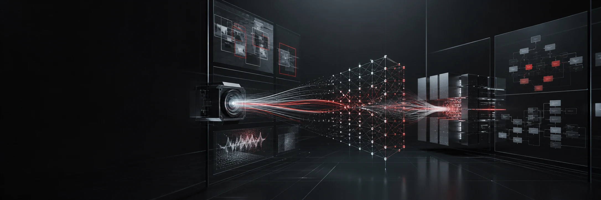
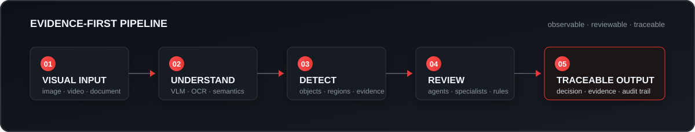
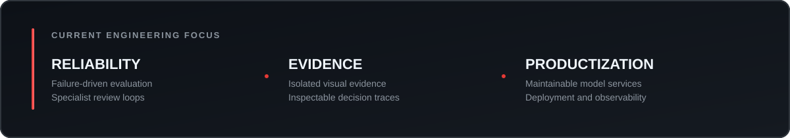

  

<h1 align="center">Hi, I'm ch.ljiang.</h1>

  <strong>I build AI systems that can see, reason, act, and be audited.</strong>

  Multimodal AI &nbsp;&middot;&nbsp; Computer Vision &nbsp;&middot;&nbsp; Agents &amp; RAG &nbsp;&middot;&nbsp; Full-stack AI Engineering

  
  

---

## What I Build

I care about the part after a model demo works: turning it into a system that is observable, reviewable, and useful in the real world.

<table>
  <tr>
    <td width="25%" align="center">
      <strong>SEE</strong> 
      VLM, detection, OCR, image understanding
    </td>
    <td width="25%" align="center">
      <strong>REASON</strong> 
      Agents, RAG, specialist review, orchestration
    </td>
    <td width="25%" align="center">
      <strong>BUILD</strong> 
      Python APIs, Vue interfaces, model services
    </td>
    <td width="25%" align="center">
      <strong>SHIP</strong> 
      Docker, Nginx, inference tracing, deployment
    </td>
  </tr>
</table>

  

## Featured Systems

<table>
  <tr>
    <td width="50%" valign="top">
      <h3><a href="https://github.com/Chan-Developer/XFDemo">XFDemo</a></h3>
      
Evidence-first multimodal fire-safety inspection. VLM and YOLO collaborate through specialist review, deterministic harnesses, traceable history, and human feedback.

      
<code>Vue 3</code> <code>Flask</code> <code>VLM</code> <code>YOLO</code>

    </td>
    <td width="50%" valign="top">
      <h3><a href="https://github.com/Chan-Developer/cinema-violation-detection">Cinema Violation Detection</a></h3>
      
A visual inspection system that combines YOLOv8 with language-model reasoning for cinema behavior and compliance analysis.

      
<code>Python</code> <code>YOLOv8</code> <code>LLM</code> <code>Vision</code>

    </td>
  </tr>
  <tr>
    <td width="50%" valign="top">
      <h3><a href="https://github.com/Chan-Developer/ReAct_agent">ReAct Agent</a></h3>
      
An agent project exploring the ReAct loop: reasoning, tool use, observation, and iterative decision-making.

      
<code>Python</code> <code>Agents</code> <code>Tool Use</code>

    </td>
    <td width="50%" valign="top">
      <h3><a href="https://github.com/Chan-Developer/agentic_rag">Agentic RAG</a></h3>
      
Experiments around retrieval workflows that let agents decide when to search, verify, and refine their answers.

      
<code>RAG</code> <code>Agents</code> <code>Retrieval</code>

    </td>
  </tr>
</table>

## Engineering Principles

> **Evidence before confidence.** A convincing answer is not enough; important conclusions should remain connected to inspectable evidence.

- Models are components, not the whole product.
- Observability is part of intelligence, not an afterthought.
- A specialist should only modify the conclusion it owns.
- Good AI interfaces make uncertainty visible and correction easy.
- The last 20% is usually deployment, data quality, and failure handling.

## Toolbox

  
  
  
  
  
  
  
  

## Current Focus

- Making multimodal inspection systems more reliable through evidence isolation and targeted review.
- Connecting visual models, detectors, agents, and deterministic logic into maintainable products.
- Building evaluation loops from real failure cases instead of optimizing only for demos.

  

---

  <strong>Build systems that do more than predict. Build systems that can explain what happened.</strong>

